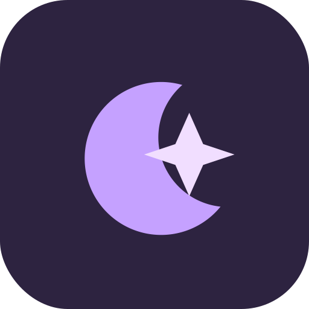

<h1 align="center">SukiRPC</h1>

<strong>E C L I P S E</strong>

One presence. Anywhere.

Discord Rich Presence for Nuvio Mobile and Nuvio TV, with a special focus on Amazon Fire TV Stick.

---

## About

SukiRPC is an independent Android companion that shares your Nuvio playback as Discord Rich Presence. It features the minimalist Eclipse interface, spring animations, automatic artwork and background synchronization. No root is required for normal operation.

## Supported platforms

| Integration | Support |
| --- | --- |
| Nuvio Mobile (Android) | Local MediaSession integration; no Collector required |
| Nuvio TV (Amazon Fire TV Stick) | Primary TV target; uses the bundled SukiRPC Collector |
| Other Fire OS / Android TV / Google TV devices | May work, but compatibility is not guaranteed |
| iOS, LG webOS, Samsung Tizen | Not supported |

> **TV support is primarily intended for Amazon Fire TV Stick.** The Collector is an Android application, not a universal Smart TV integration. Support depends on the device, OS and Nuvio version.

## Features

- Mobile, TV and automatic synchronization modes.
- Movie and series titles, episode information, artwork and playback progress when available.
- Local TV pairing via QR code or manual code, using TLS with certificate identity verification.
- Eclipse interface, OLED and other themes, spring animations, splash screen and dynamic notifications.
- Adaptive polling, MediaSession callbacks and bounded artwork caching.
- Integrated update center with APK integrity and certificate checks.
- Separate ARM64, ARM32, x86 and x86-64 builds, plus a universal APK.

## Download

Get the APK from the [official releases](https://github.com/Demmkkj/SukiRPC/releases/latest).

| APK | Architecture |
| --- | --- |
| `SukiRPC-arm64-v8a.apk` | ARM 64-bit (most modern Android phones) |
| `SukiRPC-armeabi-v7a.apk` | ARM 32-bit |
| `SukiRPC-x86.apk` | x86 32-bit |
| `SukiRPC-x86_64.apk` | x86 64-bit |
| `SukiRPC-universal.apk` | All four architectures |

The mobile app requires Android 8.0 (API 26) or later. ABI support does not guarantee that every device or Discord version is compatible. If unsure, choose the universal APK. Releases include SHA-256 checksums and update metadata.

## Getting started

### Mobile

1. Install SukiRPC on your Android phone and sign in to the Discord app.
2. Grant SukiRPC notification access so it can read Nuvio's media session.
3. Choose **Mobile** and start synchronization. Play a movie or episode in Nuvio.
4. If artwork is missing, enable the optional external mobile artwork lookup in settings.

### Fire TV Stick

1. Install the bundled Collector using the TV setup in SukiRPC. Follow the device's installation and authorization prompts.
2. Grant notification access to the Collector on the Fire TV Stick.
3. Connect the phone and Fire TV Stick to the same local network.
4. Generate a pairing code on the TV and verify its identity using QR or manual pairing.
5. Select **TV** in SukiRPC and start synchronization.

Automatic mode can select a valid local session or the paired TV. Stop synchronization when you do not want playback shared.

## Privacy and permissions

- Playback metadata is shared with Discord only for the selected integration while synchronization is active. Other users may see the resulting activity according to your Discord settings.
- Notification access enables reading the Nuvio media session; the integration filters for Nuvio packages.
- The TV connection is local and uses TLS and a pairing credential.
- Optional mobile artwork lookup sends the media title to an external metadata service (Cinemeta). Artwork URLs may use third-party image services such as TMDB and MetaHub.
- The update center contacts GitHub to check releases; installation requires Android's confirmation. You can disable automatic checks.
- Do not synchronize private viewing activity. Discord integration is intended only for eligible Discord users aged 13 or older, subject to applicable age requirements.

## Feedback

Report bugs through [GitHub Issues](https://github.com/Demmkkj/SukiRPC/issues). Include your device model, OS, SukiRPC version and integration mode. Remove pairing codes, credentials, addresses and private viewing information from logs before posting.

## Credits

Built using Kotlin, Jetpack Compose, Java, C++ and the Discord Social SDK. SukiRPC is an independent project and is not affiliated with Nuvio, Discord or Amazon. This repository contains the open-source SukiRPC application and Collector, documentation and official downloads. The private development history and proprietary Discord SDK archive are not included.

<strong>SukiRPC · Eclipse</strong> One presence. Anywhere.

## Source code and license

SukiRPC's original source code is available under the [MIT License](LICENSE). See [build instructions](BUILDING.md) and [third-party notices](THIRD_PARTY_NOTICES.md). The Discord Social SDK remains a separate proprietary dependency and is not included. Contributions via pull requests are welcome.
